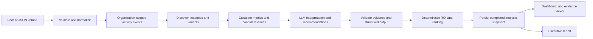

# Proposed architecture

## Status and stack

No stack has been installed or finalized. Proposed starting point, following the brief:

| Area | Proposed choice | Rationale |
| --- | --- | --- |
| Web application | Next.js, React, TypeScript | One application for dashboard and server endpoints |
| Styling | Tailwind CSS | Consistent, responsive UI |
| Persistence | PostgreSQL with Drizzle | Relational evidence links and explicit schema/migrations |
| Workflow visualization | React Flow | Inspectable workflow nodes and transitions |
| AI | Server-side provider adapter with validated structured output | Keep credentials private and analysis portable |
| Processing | Persisted analysis runs, initially executed by a bounded server-side job runner | Simple demo path with explicit status and retries |

These are project proposals, not library-version or platform compatibility claims. Confirm compatible versions and record the final choices during scaffolding. Do not introduce separate microservices or a queue until runtime limits or processing needs justify them. A production deployment must use a durable worker or job service if execution cannot safely finish in the request lifecycle; do not rely on unawaited background promises.

## Data flow



## Module contracts

- **Ingestion:** parse uploads, validate the common contract, preserve source provenance, enforce idempotency, and return a persisted import summary.
- **Discovery:** group events by explicit business-object identity, calculate ordered sequences and variants, and expose inferred labels for human review.
- **Metrics:** calculate frequency, active effort, elapsed time, and transitions from normalized events. No LLM arithmetic.
- **Candidate detection:** find repeated manual steps and elapsed-delay patterns using versioned rules. A long delay is evidence to investigate, not proof an approval is unnecessary.
- **AI analysis:** consume a minimal structured metric/evidence bundle; explain candidate issues and propose practical improvements, including options that do not use AI.
- **ROI and ranking:** apply versioned formulas to measured inputs and explicit assumptions. Reject missing or invalid inputs rather than silently inventing them.
- **Recommendation store:** persist opportunities, evidence links, confidence, review state, assumptions, and run provenance.
- **Reporting:** render the same persisted results as the dashboard, with source coverage and uncertainty. Any generated narrative must use validated findings and calculations.

## Suggested source layout

```text
src/
  app/                  # Pages and server endpoints
  components/           # Shared presentation components
  modules/
    ingestion/
    discovery/
    metrics/
    analysis/
    opportunities/
    reporting/
  db/                   # Schema, migrations, organization-scoped queries
  server/               # Provider configuration and job runner
fixtures/               # Synthetic input exports; independent expected results
scripts/                # Dataset generation, demo reset, verification
```

The domain modules should accept explicit inputs without depending on page rendering, so calculations and provenance can be checked independently.

## Analysis lifecycle and reproducibility

Persist `queued → running → completed | failed`, with stage, timestamps, safe error details, and an explicit retry action. A retry creates a new attempt; it must not duplicate imported events or overwrite a completed snapshot in place.

Each run records organization, immutable input membership or snapshot hash, import IDs, discovery/rule/scoring versions, assumption set, prompt version, provider/model identifier, and normalized model output. Pin these inputs when a run starts so a concurrent import cannot change its results. Retain enough model request provenance to audit an answer while applying the configured retention and minimization rules.

Views use completed runs only. A failed rerun must not make earlier results appear current. LLM phrasing may vary; numerical metrics, evidence validity, and ranking remain reproducible for fixed inputs and assumptions.

## Trust and data handling

Use synthetic data for development and the hackathon. Keep raw imports separate from normalized and derived records. Apply organization scope to every query, evidence lookup, cache key, and run. Pseudonymous actors support process reconstruction, not employee performance rankings.

Treat uploaded strings as untrusted data, including potential prompt instructions. Do not execute them or let them override analysis instructions. Validate model outputs against a schema, organization/run scope, known evidence IDs, and allowed recommendation fields. Use deterministic values for displayed numbers.

Keep provider secrets server-side. Send only the fields necessary for analysis; exclude secrets, unrelated personal data, and unnecessary raw payloads. Future real-data pilots require documented access controls, approved provider/data handling, read-only connector scopes, retention periods, and deletion propagation across raw data, derived records, and provider-side storage where applicable. The synthetic demo does not establish production readiness.
